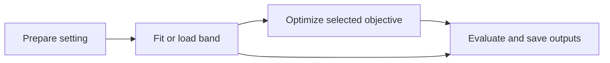

# Plan: settings, optimization, bands, and outputs

Status: planning only for the source refactor. The separately authorized archive
moves are recorded in `scratch/retired_experiments/relocations*.json`. Continue
review through PR #182; do not merge it without an explicit request.

## The workflow to expose

One experiment family has one configuration entry point. The user chooses:

1. A documented setting: synthetic observations or a fixed Generali cohort/model.
2. Optimization: objective target, policy, first-order/zeroth-order estimator,
   existing solver, initialization, constraints, and stopping rules.
3. Band construction: established OLS, wild-bootstrap, or support-based method.
4. Outputs: saved numeric state, optimization traces, metrics, and report recipes.

The execution order for a conservative objective is:



A band used by the optimizer must exist before the optimizer queries it. An
explicit `band: none` baseline can optimize the predictor alone; an evaluation-only
band can instead be attached to a saved optimized policy. Never silently rerun
optimization when the request is only to replot or evaluate saved results.

All reported solutions continue to use `src/optimization/` or exact saved outputs
with provenance. Display grids never choose an optimizer action. Preserve the
existing first-order, finite-difference, Stein-difference, Gaussian-Stein, and
SPSA methods and supported solver combinations; this refactor adds no estimator.

## What the current code already provides

| Responsibility | Reuse | Current friction to remove |
|---|---|---|
| Optimization | `ExperimentConfig`, `run_experiment`, `execute_experiment_run`, `src/optimization/`, existing `Objective`/`Policy` interfaces | Illustration drivers build their own query-only objectives and launch paths |
| Calibration and bands | `envelopes/core.py`, `linear.py`, `wild.py`, polynomial certificates | The generic fitted-envelope interface is symmetric; active residual bands have different lower/upper radii and their calibration is embedded in `wild_study.py` |
| Synthetic settings | Existing synthetic objectives, `wild_study._environment`, current data-location drivers | Truth, logging distributions, noise, frozen predictors, and seeds are spread across manifests and Python constants |
| Generali settings | `configs/real_data_factory.py`, loaders, `reporting/real_data.py`, model/cache interfaces | Cohort identity, model inputs, policy features, and calibration observations must be passed together without losing row alignment |
| Support construction | `data/coverage.py`, `objective/gridded.py`, existing kernel mathematics | Customer-local support and action-only kernel support are different constructions; normalization/interpolation must stay explicit |
| Results and replay | `results.py`, `reporting/`, `manifest.py`, `provenance.py`, launch/Slurm support | Specialized runners have their own contracts and absolute paths; changing a configuration currently often requires another project name |

The seams already have real variation: synthetic versus Generali settings,
several band constructions, and several established estimators. Put the depth
in those modules, with small interfaces; avoid a parallel runner framework or a
new class for every variant.

The proposed file targets are deliberately limited:

| Target | Change |
|---|---|
| `experiments/settings/{synthetic,generali}.py` with a small package interface | Prepare the two setting types using existing factories and loaders |
| `experiments/envelopes/core.py` | Extend fitted-state/evaluation contracts to explicit endpoints and method capabilities |
| `experiments/envelopes/{linear,wild}.py` and a support adapter if needed | Keep fitting/calibration mathematics behind the common band interface |
| `objective/banded.py` if existing objective adapters cannot express the composition | Translate a selected band endpoint and policy into the existing `Objective` interface |
| `experiments/{manifest,execution,results}.py` and existing seed modules | Compile configuration, preserve execution/seed semantics, and carry the fitted state through results |
| `experiments/reporting/` and `reporting/` | Extend the existing reporters and saved-artifact recipes |

These paths are under `src/`. New files must remove duplication across current
callers; do not add empty adapters or duplicate `ExperimentConfig` in a second
configuration hierarchy. Shared mathematical extraction can add a cohesive
certificate module only after its consumers are enumerated.

## 1. Keep family identity stable

Use one canonical manifest per scientific family, with named conditions or axes
inside it. A change in noise distribution, sample size, bootstrap count, logging
location, solver settings, or presentation normally stays in that family.
A distinct question or explicit user request can justify another family.

For new runs, separate family identity from run identity:

```text
manifests/<family>/experiment.json
manifests/<family>/SETUP.md
results/<family>/<run-revision>/<condition>/seed-<id>/
```

A revision contains the fully resolved configuration, source revision, input
hashes, seed mapping, and method version. Identical contracts may resume;
incompatible contracts start another revision under the same family. Report
changes read an existing revision. Do not overwrite saved results, rename
historical provenance, or force old checkpoints through a changed contract.
The legacy flat layout stays readable; only new runs use the proposed layout.

The manifest remains JSON. Its proposed blocks are `family`, `setting`,
`optimization`, `band`, `seeds`, `launch`, and `reporting`. This is a design sketch,
not an already supported schema. Extend the existing manifest parser and compile
these choices into the existing execution path. Keep a small legacy-schema
adapter where needed during migration; retire obsolete specialized dispatch once
its remaining callers are archived.

## 2. Document and prepare settings independently of the method

Add a narrow settings module under `src/experiments/settings/`, with synthetic
and Generali adapters using the existing factories/loaders. Its one preparation
interface returns the observations, predictor, decision cohort, policy inputs,
domain, and provenance needed downstream. Keep optional synthetic truth in an
evaluation-only view; band fitting receives observed data and never truth.
Reuse `CalibrationData` for numeric calibration arrays. Preserve raw DataFrames
and original row IDs where Generali models need them; do not force every model
through an anonymous numeric array.

Each family's `SETUP.md` describes the scientific question and explains its
parameters. Generate each run's `EXPERIMENT.md` from the resolved manifest so
reported settings cannot drift from executed settings. The setup specification
must record:

- Context/action domain, policy class, objective units and minimize/maximize sign.
- Truth when known, frozen predictor origin, feature map and coefficients.
- Logging design, observations, noise scale/innovation law, and covariance or
  dependence across inputs; whether the design is frozen or redrawn.
- Exact off-grid evaluation, any interpolation, optimizer query/boundary behavior,
  display-only grids, and global-reference/certification method and tolerance.
- Calibration cohort, decision/evaluation cohort, split policy, and original row
  IDs; which sweep axes reuse observations, fitted predictors, or bootstrap draws.
- Confidence event/domain, assumptions and calibration derivation; distinguish
  a guarantee, empirical coverage, and a descriptive support penalty.
- Complete seed ownership and artifact provenance, with links to `MATH.md`.

Switching from synthetic to Generali should change the setting block and declared
method parameters, not the runner or output format. It does not make every
method scientifically valid for both: validate the required observations,
feature rank, variance assumptions, domain, and model capabilities before launch.
A Generali predictor is not ground truth. Regret/coverage requiring unknown truth
must be explicitly unavailable rather than computed against another fitted model
and labeled as true regret/coverage.

## 3. Give established bands one useful interface

Deepen `src/experiments/envelopes/` rather than creating a second band package.
The proposed small interface is:

- `fit_band(observations, predictor, domain, method_spec, rngs)` returns fitted,
  serializable numeric state and its calibration metadata.
- `band.evaluate(contexts, actions)` returns center, lower endpoint, upper
  endpoint, and optional construction diagnostics.

Names are proposals; reuse existing types where they fit. Endpoints are the
common representation because residual constructions are asymmetric. Preserve
the exact lower/upper radii and transfer rule; do not reinterpret them as one
symmetric half-width. Preserve direct fitted-function bands separately from
frozen-predictor residual-transfer bands.

Supported adapters should wrap the existing mathematics:

| Method | Preserve explicitly |
|---|---|
| OLS analytical transfer | Current variance bound, covariance, radius formula, feature rank checks and confidence event |
| OLS pairs bootstrap, when requested | Resampling unit, fixed denominator, quantile/Monte Carlo rule, rank-deficiency policy and pairing |
| Residual wild bootstrap | Raw residual convention, Rademacher multipliers, frozen predictor, asymmetric transfer, bootstrap order statistic and saved draws |
| Current quadratic/contextual wild illustrations | Their existing all-real polynomial or coefficient-ball calibration; these are distinct calibration rules |
| Support-based construction | Exact support definition, normalization, scale/bandwidth, interpolation and domain; no automatic probability guarantee |

Band metadata carries assumptions, conditioning, finite/simultaneous scope,
calibration status and numerical certification. Unsupported guarantees remain
absent. Keep realized containment tests and repeated-simulation coverage reports
outside fitting. Reuse existing certificates without silently substituting a
new optimum or a grid-based reference.

Extract shared polynomial features/certificates from `bootstrap_band.py`,
`bootstrap_band_continuous.py`, and `offline_bootstrap_math.py` before retiring
their study orchestration. Move only the used Fourier-GP representation from
`policy_lcb/continuous_gp_core.py` into the synthetic-setting implementation;
keep its construction and saved seed mapping exact. Place Wilson intervals and
shared JSON/provenance helpers with their reusable consumers. Audit imports
before naming new helper files; avoid creating one-line forwarding modules.

## 4. Connect bands to the existing optimizer

Use an `Objective` adapter for the selected target: predictor alone, lower return
bound, or upper cost bound. Make the sign convention explicit. Delegate execution
to the existing runner and solver setup, including constraints, batching and
policy-chain gradients. Existing Generali acceptance constraints must survive
this composition.

Expose gradient capability explicitly. First-order execution requires a valid
gradient for the complete target; query-only bands and raw models without one
must reject that choice before submitting work. Never silently change estimators.
Preserve both theta-space and action-space perturbations and the personalized
Stein scaling currently tested by the contextual illustration.

A support-grid adapter retains its actual interpolation rule, cohort alignment,
action interval and outside-domain behavior. Add bounded-continuous domain
semantics deliberately: current `TargetDomain` distinguishes only a finite set
and all-real action fibers. A plotted grid does not establish continuous coverage.

## 5. Standardize saved output and replay

Extend existing result/reporting modules to save one result bundle per run:
resolved setup, input/band state, optimizer settings and traces, final policies
and actions, evaluated endpoints, metrics, and artifact provenance. Use the
existing reporter/recipe path for PDF/CSV output. Large Generali arrays remain
separate numeric artifacts rather than expanded JSON.

Synthetic outputs may include truth, regret and coverage. Generali outputs use
model-based value, action/acceptance summaries, support diagnostics and band
endpoints with their assumptions. Keep the schemas compatible while marking
unavailable metrics explicitly. Preserve per-context band evaluation before
averaging; do not average inputs and then construct a different band.

For new bundles, identify inputs by hashes and stable paths relative to the
bundle or an explicit artifact root. Record original absolute locations as
provenance, not the only way to find a file. Existing archives remain immutable;
recover old source/path contracts through their relocation maps. Fix the known
shared `write_json_atomic` temporary-filename race before enabling concurrent
new-contract runs, without changing any simulation RNG stream.

## Delivery sequence and acceptance checks

This is `worktree-required` work: new reusable modules plus configuration,
seeding, execution, exports, and generated documentation are affected. Use a
dedicated worktree, incremental commits, and reviewable PRs; keep PRs open.

| PR | Scope | Acceptance check |
|---|---|---|
| A: extract mathematics and define band outputs | Narrow helper extraction, endpoint interface, adapters for current residual/illustration bands | Saved arrays and deterministic small fixtures reproduce current coefficients, radii, endpoints, bootstrap quantiles and certificates |
| B: setting specifications and one execution path | Synthetic and Generali setting adapters, capability checks, manifest compilation, existing optimizer integration | Run a small retained synthetic setting and an existing Generali support setting through the same interface; preserve objective signs, actions, constraints and seed pairing |
| C: family revisions, setup documents and reporting | Resume identity, portable new artifact paths, generated setup documentation, shared reporting/replay | Changed settings make another revision in the same family; replay neither refits nor optimizes; missing truth/capabilities stay explicit |
| D: retire obsolete source orchestration | Move concluded study runners, private plots and their study-only tests into scratch; prune exports/dispatch/generated docs | Current workflows import only reusable `src/`; core behavioral tests remain active; archived studies remain recoverable |

For PR D, candidates include finite/continuous/GP policy-LCB study drivers,
old bootstrap/kernel sweep orchestration, and generic-envelope study/report
recipes. Do not move their reusable mathematics. Audit eager imports in
`experiments/__init__.py`, `envelopes/__init__.py`, and the shared CLI first.
Keep raw Generali loaders/models, presets, policy-capacity tooling and shared
reporting available even though their completed results are archived.

Proposed tests cross the same interfaces as callers: band parity and asymmetric
endpoints; observation/truth separation; deterministic paired seed streams;
setting/cohort and method-capability validation; optimizer target/constraint
parity; configuration-sensitive resume and output-only replay. Use existing
small deterministic fixtures and saved artifacts first. Confirm this test
structure before adding new tests, as required by `AGENTS.md`; the current
archival pass changes only existing test paths. Run relevant tests and a small
demo per PR, then required broader checks; regenerate pdoc for public docstring
changes and update README/AGENTS/MATH references as needed.

Before implementation, confirm the scientific choices that the interfaces cannot
supply: the Generali quantity to calibrate (for example cost/profit versus
acceptance), the matching observed response/cohort and assumptions, and ownership
of any newly introduced seed streams. Existing named wild-study streams
(contexts, actions, profile, observations, method) and exact derived seeds must
survive migration. Do not add stochastic behavior or silently fold those streams
into the optimizer seed. Capture the representation decisions above in the
first implementation plan and obtain the repository-required confirmation.

## Archive selection now in effect

The first pass archived 18 manifests, nine drivers and 22 result directories.
The follow-up archives 29 more synthetic manifests, 40 Generali result folders,
34 earlier synthetic result folders, and two Generali frontier output folders
from the canonical checkout. Generali source/data/models and seven manifests
stay available. The retained synthetic manifests are the three paired-residual
distribution studies and six fixed-noise residual-leverage settings.

Keep `terminal-distribution-sweeps/`, all four `residual-heteroskedastic*` folders,
the six fixed-noise residual-leverage result folders, and the three current/earlier
data-location illustration folders. Shared cache/log folders remain. These
archive moves are separate from the proposed source refactor and do not change
any method or rerun any study.
